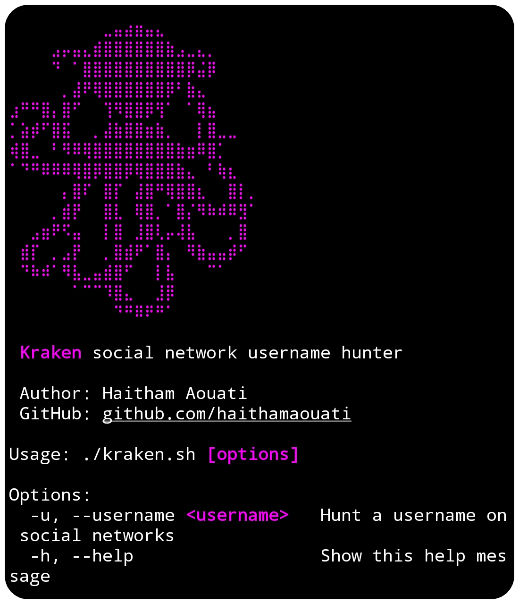

# Kraken
Kraken 🐙 social network username hunter



## Table of Contents

- [Install](#install)
- [Usage](#usage)
- [Dependencies](#dependencies)
- [Environment](#environment)
- [Disclaimer](#disclaimer)

## Install

To use the Kraken script, follow these steps:

1. Clone the repository:

    ```
    git clone https://github.com/haithamaouati/Kraken.git
    ```

2. Change to the Kraken directory:

    ```
    cd Kraken
    ```
    
3. Change the file modes
    ```
    chmod +x kraken.sh
    ```
    
5. Run the script:

    ```
    ./kraken.sh
    ```
## Usage

Usage: `./kraken.sh -u <username>`

## Dependencies
The script requires the following dependencies:

- **curl**: `pkg install curl - y`

> [!IMPORTANT]  
> Make sure to install these **dependencies** before running the script.

> [!NOTE]
> The scraping technique relies on the current structure of the social networks websites, which may change.

## Environment
- Tested on [Termux](https://termux.dev/en/)

## Disclaimer
>[!CAUTION]
>This Tool is only for educational purposes

> [!WARNING]
> We are not responsible for any misuse or damage caused by this program. use this tool at your own risk!
